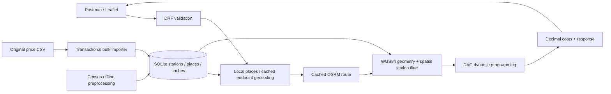

# Fuelway — Django fuel route optimizer

A focused US driving-route API: one OSRM route request, local station matching, and a
minimum-cost feasible fuel plan under a clearly stated estimation model. Django serves
a responsive Leaflet demonstration, JSON API and OpenAPI documentation. No Node, Redis or background workers are required. Local setup uses SQLite; the
Render deployment uses managed PostgreSQL for persistence.

**Delivery status:** The original 8,151-row CSV is imported: **8,125 records**, **26 exact
duplicates**, **zero rejected rows**. **7,033** stations have approximate Census locations;
**1,092** remain unresolved (620 Canadian records, 428 unmatched US places and 44 ambiguous
US places). Austin–Dallas and Miami–Ellensburg plans were verified against real prices
and live OSRM. See `docs/verification.md` for evidence and remaining limitations. Production deployment
configuration and secure dataset setup are in `docs/render-deployment.md`.

Verified public deployment: [demo](https://fuel-route-optimizer-edcq.onrender.com/demo/),
[Swagger](https://fuel-route-optimizer-edcq.onrender.com/docs/),
[health](https://fuel-route-optimizer-edcq.onrender.com/api/v1/health/).
The real dataset is loaded in managed PostgreSQL; both example routes passed the public
HTTP audit on 14 October 2026. Free PostgreSQL expires on **13 November 2026**.

## Local setup

Requires Python 3.13 (3.12+ is supported by Django; this project's lock was exercised
on Python 3.13.4). All direct and transitive dependencies are pinned with hashes in
`requirements.txt`; `requirements.in` records the direct selections.

```bash
python3 -m venv .venv
source .venv/bin/activate
python -m pip install --require-hashes -r requirements.txt
cp .env.example .env
python manage.py migrate
python manage.py prepare_locations
# Place the evaluator's unchanged CSV at the following path first:
python manage.py load_fuel_prices --csv data/fuel-prices-for-be-assessment.csv
python manage.py check
python -m pytest -q
python manage.py runserver 127.0.0.1:8000
```

Choose one server path at a time: `docker compose stop` releases port 8000 before
starting the local Python server. Alternatively use port 8001 for local development.

Open [demo](http://127.0.0.1:8000/demo/), [API docs](http://127.0.0.1:8000/docs/),
[OpenAPI JSON](http://127.0.0.1:8000/openapi.json) or
[health](http://127.0.0.1:8000/api/v1/health/). The health endpoint is live even before
import, but `ready_to_plan` is false. Missing source data produces a clear 503, not a
fabricated successful route.

In PowerShell use `.venv\Scripts\Activate.ps1`. The API has no session authentication
requirement, so Postman sends JSON without a CSRF token. It is an evaluation API, with
local request throttling, not a deployed multi-tenant service.

Supported cities such as `Austin, TX` resolve using local Census places. For arbitrary
full addresses, consciously opt in to an appropriate geocoding service by setting
`GEOCODING_ENABLED=true` and a real, identifying `GEOCODING_USER_AGENT`, such as your
application name plus your contact URL. Read the provider policy below first. Direct
coordinates avoid geocoding entirely and are checked against US state polygons.

## Docker setup

Requires Docker with Compose v2.24+ (supports optional `env_file`). The image uses Python
3.13, hashed dependencies, a non-root user and Gunicorn. SQLite/cache locks persist in
`app-state`; geographic reference data persist in `geographic-data`. The original CSV
is mounted read-only from `./data` to `/app/input`, not copied into the image.

```bash
cp .env.example .env
docker compose build
docker compose up -d
# Migrations run in the entrypoint. Prepare the two data inputs explicitly:
docker compose exec web python manage.py prepare_locations
docker compose exec web python manage.py load_fuel_prices --csv /app/input/fuel-prices-for-be-assessment.csv
docker compose exec web python manage.py check
docker compose exec web python -m pytest -q
docker compose logs web
```

URLs are the same as local setup. `docker compose down` preserves volumes. The entrypoint
also supports `docker compose run --rm web python -m pytest -q`. Never remove volumes
unless you intend to discard local imported data. Docker was unavailable during the initial implementation; the final verification built and ran
the container, imported the real data and exercised the full test suite. See the report.

For deployment set `DJANGO_DEBUG=false`, provide a persistent unique `DJANGO_SECRET_KEY`,
set allowed hosts, and run behind an HTTPS reverse proxy. Gunicorn handles the dynamic
pages; the demo's Leaflet assets use a versioned CDN and its styles/scripts are inline.
For example, generate the secret locally with
`python -c 'import secrets; print(secrets.token_urlsafe(48))'` and put it in the ignored
environment file. See `manage.py check --deploy` for environment-specific HTTPS settings.
HTTPS/HSTS options are documented in `.env.example` and intentionally off for local
HTTP. Enable them only for the deployed HTTPS host; trust forwarded protocol headers
only when your reverse proxy overwrites them. The development profile produces expected
deployment-security warnings and is not presented as a verified production deployment.

## API

| Method and path | Behavior |
|---|---|
| `POST /api/v1/route/plan/` | Resolve endpoints, route, filter stations, optimize and return the plan |
| `GET /api/v1/health/` | Liveness, imported/located/unresolved counts and readiness; no external requests |
| `GET /demo/` | Interactive route and numbered fuel stops from this API |
| `GET /docs/` | API documentation with a live request example |
| `GET /openapi.json` | OpenAPI 3.1 schema; compatible with Postman/Swagger tooling |

```bash
curl -sS http://127.0.0.1:8000/api/v1/health/
curl -sS -X POST http://127.0.0.1:8000/api/v1/route/plan/ \
  -H 'Content-Type: application/json' \
  -d '{"start":"Austin, TX","finish":"Dallas, TX"}'
```

Austin–Dallas was verified at **195.9715 miles**, **3 stops**, **19.5971 gallons** and
**$54.55**. The verified long example is **Miami, FL → Ellensburg, WA**: **3,196.5477
miles**, **15 stops**, **319.6548 gallons**, **$978.35**. These are measured examples,
subject to provider/data changes. Run `python scripts/find_demo_routes.py` to regenerate
verified routes and a Postman environment, then `python scripts/verify_live_api.py` for
an independent cost/range/source-price and external-call audit. The latter deliberately
expires only those example route cache entries and makes one live OSRM call per example.

Coordinate input, or a mix of coordinates and an address, is supported:

```json
{
  "start": {"latitude": 30.2672, "longitude": -97.7431},
  "finish": {"latitude": 32.7767, "longitude": -96.7970}
}
```

Optional numeric parameters: `max_range_miles` (1–1000, default 500), `miles_per_gallon`
(1–100, default 10), `max_station_detour_miles` (0–50, default 20). This last value is
an **approximate one-way perpendicular corridor radius**, not a routed round-trip detour.
Tank capacity is derived as range/MPG (50 US gallons by default). Empty/overlong addresses,
unknown fields, nonfinite/boolean numbers, missing coordinates and non-US endpoints are
rejected. There are 50 states plus DC; territories are excluded.

A successful response contains these actual, calculated fields:

```text
route: origin/destination coordinates, distance_miles, duration_minutes, GeoJSON geometry
vehicle: max_range_miles, miles_per_gallon, derived_tank_capacity_gallons
fuel_summary: gallons, total cost, departure fuel value, allocated en-route cost,
              departure price source and every priced leg
fuel_stops[]: sequence, internal/source IDs, name/address/city/state, coordinates/source,
              retail price, route offset/corridor distance, outgoing-leg gallons/cost
optimization: objective, method, feasibility, candidate count, cache hit, assumptions
attribution: providers
```

No sample station names, prices, route geometry or successful response values are hard-coded.
The JSON schema describes the full response. A short route can have zero stops, but its
departure fuel cost is still included; a reachable lower price may justify a stop even
when a route fits within one tank. The map uses returned geometry and coordinates and
never calls a route provider independently.

Errors have a stable envelope, for example:

```json
{
  "error": {
    "code": "no_feasible_refueling_plan",
    "message": "The located stations in this route corridor leave a gap longer than the vehicle range.",
    "details": {"max_range_miles": 500, "candidates_evaluated": 12},
    "request_id": "server-generated-correlation-id"
  }
}
```

This is a structural error example, not a recorded route. Codes include `validation_error`
(400), `non_us_location` (400), `location_not_resolved` (400 when geocoding is disabled),
`location_not_found`/`no_route` (404), `departure_price_unavailable` and
`no_feasible_refueling_plan` (422), throttling (429), invalid/upstream HTTP responses (502),
and missing data/provider timeout or contention (503). No traceback is returned. The
`X-Request-ID` header matches the error correlation ID.

## Architecture and request flow

Django provides migrations, indexed data access, transactions, configuration and simple
page serving. DRF provides JSON handling, structured validation and consistent HTTP
errors. Services are independently testable, and views coordinate only the HTTP boundary.



`fuel_optimizer/services/` separates geocoding, routing, geometry, station matching,
optimization and cost calculation. The algorithm accepts in-memory candidates without
a web server or external calls. SQLite is sufficient for this approximately 8,151-row
assessment. A separate preprocessing command owns geographic downloads.

## Price import and station locations

See `data/README.md` for the seven CSV headers, duplicate rule, validation and snapshot
semantics. Source IDs can repeat; internal IDs and hashes preserve legitimate separate
records and differing prices. The default importer validates **all** rows, then bulk
creates/updates/removes stale snapshot records transactionally. Bad input cannot erase
the previous dataset. Reimporting identical data is idempotent. Counts include loaded,
updated, skipped, duplicate, invalid, removed, located and unresolved.

The official [2025 Census Gazetteer Places](https://www2.census.gov/geo/docs/maps-data/data/gazetteer/2025_Gazetteer/)
provides representative place internal points. `prepare_locations` also downloads
state polygons for direct-coordinate validation. Archives are cached and their hashes
recorded; use explicit archive paths for offline setup. Import matches unique normalized
city/state combinations locally and records unmatched/ambiguous locations in
`var/unresolved-stations.csv`. No live station geocoding fallback is included.

These are **city/place approximations, not verified pump locations**. Responses contain
`coordinate_source=city_centroid_approximation` and the Census GEOID source reference.
Stations sharing a centroid remain distinct in storage; a strictly cheaper price at
the same projected route position dominates within this estimation model. Missing or
ambiguous geographic matches are retained as unresolved but excluded from optimization.

## Geometry and candidate filtering

WGS84 ellipsoidal segment lengths come from pyproj. Full provider geometry is retained
for display. Calculation geometry is densified to at most five-mile segments and indexed
with Shapely's STRtree. Up to 80 overlapping conservative bounding boxes query only
nearby station records through indexed coordinates. For each remaining station, nearby
segments are projected using great-circle bearings and along-track angles, followed by
ellipsoidal distance checks. All distances are in miles, never raw degree subtraction.
Longitudes are unwrapped for Alaska/dateline indexing.

Geodesic cumulative geometry distances are proportionally scaled to the OSRM road
distance so origin, destination and all station offsets share one consistent mileage
axis. Clearly inconsistent/zero-length provider geometry is rejected. The nearest
projection is approximate (especially for city coordinates); crossings and repeated
passes choose the closest/earliest projection. Corridor distance is measured to that
point. No per-station provider calls occur, and route offsets preserve driving order.

## Optimization and complete cost model

The stated objective is **minimum estimated cost under the outgoing-segment price
model**, not globally optimal real-world fill quantities or driving detours.

1. Departure fuel is available up to the vehicle's range. Value consumed departure
   inventory at the **cheapest imported price** from a located candidate within 20
   straight-line miles of origin and within 20 route miles of departure (configurable
   `DEPARTURE_PRICE_RADIUS_MILES`). This is a disclosed price proxy, not a claim that
   the route physically visits that station. Without a departure price, return 422.
2. Add departure (offset 0), stations ordered by offset, and destination (offset D).
   Edges go only forward and exist when the OSRM-scaled offset difference is at most
   the selected range. No station beyond the corridor is eligible.
3. A source node's outgoing leg costs `(end_offset - start_offset) / MPG × source_price`.
   Dynamic programming computes `best[j] = min(best[i] + edge_cost(i,j))`. Backtracking
   produces the minimum modeled cost sequence. Equal costs prefer fewer legs; exact
   position ties use lower price and then stable internal ID. Costs compare unrounded
   double precision within $1e-9. No candidate is pruned merely for being expensive;
   an expensive bridge can be essential. Missing coverage returns 422.
4. Total fuel consumed is **D/MPG**. Every route mile, including first and last legs,
   is assigned once. Displayed leg costs use Decimal half-up cents; total cost is the
   sum of those displayed leg costs, so it reconciles exactly. Gallons/distances have
   four decimals; driving duration has two. The per-stop `estimated_leg_*` fields refer
   to the **outgoing** leg, and `fuel_summary.legs` also includes the first departure leg.
5. `departure_fuel_value_usd` and `estimated_en_route_allocated_fuel_cost_usd` separate
   inventory valuation from later allocations. Neither is an actual purchase receipt.
   Tank mixing, leftover inventory and quantities purchased are not simulated. You can
   provision each modeled leg with its required gallons (<= tank capacity), but the
   estimate does not claim a physically exact transaction history.

The DAG algorithm is optimal for this additive edge model, up to stated numeric
tolerance; rounding can change displayed costs by up to half a cent per leg. It is
O(NK) time for K feasible predecessors per node (worst-case O(N²)), with O(N) DP memory.
Binary search excludes predecessors beyond range. Duplicate centroid positions reduce
the graph substantially. Fuel stops may exceed the mathematically minimum count when
cheaper segments reduce the modeled cost.

**Road detours are excluded** from D/MPG and from range checks, as the assessment's
recommended route-distance formula specifies. `all_legs_within_max_range` means modeled
route gaps are feasible. It cannot guarantee actual 500-mile pump-to-pump driving with
approximate stations and unknown access roads. Verify access/range before real travel.

## Providers, rate limits and caching

- OSRM uses exactly one `route/v1/driving/...` request per cache miss, with full GeoJSON,
  no turn-by-turn steps, finite connect/read timeouts and no automatic retries. Invalid
  JSON, distances, geometry, `NoRoute`, HTTP failures and timeouts have typed errors.
  The [public OSRM demo](https://project-osrm.org/) is suitable for evaluation and has
  **no production SLA**. Set `OSRM_BASE_URL` to a self-hosted compatible deployment;
  other providers replace the small routing adapter and should preserve its contract.
- Successful routes persist in SQLite for 24 hours by default. Keys include six-decimal
  endpoint coordinates, base URL and adapter version. Vehicle/corridor settings do not
  affect route geometry; optimization is recalculated with current station data and
  request settings. Thus price reimports do not require invalidating cached geometry.
- Successful endpoint geocoding persists for 30 days by default, keyed by normalized
  address and provider URL. Each endpoint is geocoded at most once on a miss; local
  city/state matches and coordinate input require zero geocoding calls. Expired entries
  are replaced on use. Provider errors are not cached.
- [Public Nominatim's current policy](https://operations.osmfoundation.org/policies/nominatim/)
  requires identifying contact details, attribution, cached responses and an aggregate
  maximum of one request/second. It must be a deliberate developer choice and is
  **disabled by default** here. The user explicitly requested this provider option.
  A process-shared file lock serializes requests on one host, with 1.1 seconds between
  the preceding response and the next request. Full addresses trigger searches only
  on form submit; there is no autocomplete, batch station lookup or retry loop.
  Multiple replicas need a shared limiter or a self-hosted/contracted provider.
- Per-key process-shared locks suppress duplicate concurrent geocoding/route misses.
  Lock waits are bounded at 30 seconds. State volumes must be shared by workers on
  this single host. Cached responses survive application restarts.
- Leaflet uses [OpenStreetMap tiles](https://operations.osmfoundation.org/policies/tiles/)
  with visible attribution, normal browser caching and an allowed Referer. There is no
  tile prefetch, scraping or offline download. `MAP_TILE_URL` is configurable; update
  attribution when changing provider. Leaflet 1.9.4 is loaded from a versioned CDN.

Typical external requests: cached plan **0**; new city/coordinate route **1 OSRM**;
new full-address pair **<=2 geocoding + 1 OSRM**. Geographic downloads happen during
image builds or explicit local preprocessing, never during a plan request. Live adapter
counters and automated tests verify these counts.

## Tests and verification

```bash
python -m pytest -q
ruff check .
ruff format --check .
python manage.py check
python manage.py makemigrations --check --dry-run
```

Tests cover CSV validation/idempotency/rollback/source ID collisions, ambiguous matches,
both Gazetteer delimiters, API inputs and stable errors, US constraints, provider
failures, timeouts, geometry/coordinate order/corridor/dateline, hand-calculated costs,
required expensive bridge stops and infeasible gaps. A randomized exhaustive path
oracle checks small DAGs. Call-count/cache tests and an 8,151-record **synthetic** search
test prevent station-by-station network activity. Every test has live HTTP disabled.
The supplied-CSV integration test ran successfully with all 8,151 rows. The current
suite has **112 passing tests and no skips** locally and in SQLite/PostgreSQL Docker.
CI omits the private dataset and legitimately skips its supplied-CSV test.

After local import, audit a running local or public deployment without printing source rows:

```bash
python scripts/verify_http_api.py --base-url https://fuel-route-optimizer-edcq.onrender.com
```

This verifies HTTP behavior, source-exact prices, Census coordinates, geometry, leg
limits, reconciled totals, invalid inputs and cache reuse. The separate live Django
audit above verifies the unrounded optimum and exact external adapter call counts.

See `docs/verification.md` for actual results and live-provider checks. The Leaflet demo
and documentation can load without price data; successful planning needs the original
CSV and geographic preprocessing. This distinction is intentional and transparent.

## Demonstration and publication

See `postman/README.md`, the importable collection, `docs/loom-demo-script.md` and
`docs/submission-checklist.md`. `scripts/find_demo_routes.py` verifies real success
examples before producing environment variables; it writes no fake success responses.
The optional local timeout demonstration is clearly labeled, disabled by default and
cannot be enabled when DEBUG is false.

The original CSV remains byte-identical and ignored because redistribution permission
was not supplied. Its presence alone does not establish permission to publish it. There are no committed credentials, local databases, virtual environments, private
previews or downloaded archives. The source is published at
[GitHub](https://github.com/Sakinaa72/fuel-route-optimizer).

For subsequent reviewed source updates, keep the private dataset excluded:

```bash
git status --short
git add .
git diff --cached --stat
git diff --cached --check
git commit -m "Describe the reviewed change"
git push origin main
```

The actual GitHub and application URLs are in the checklist. Rehearse
the five-minute script using verified routes, then record and upload the Loom yourself.

## Limits and next production steps

The principal limitations are approximate/missing station coordinates, retail prices
as a static CSV snapshot, departure price coverage, unmeasured station access detours,
public provider availability and the simplified segment-price fuel model. The route
itself may cross Canada between US endpoints; only endpoints are US-constrained.
The suggested Houston–Chicago pair returned `departure_price_unavailable`: no usable
imported price falls within the configured 20-mile departure radius for that route.
This is a genuine price-coverage limitation, not a fabricated success. Canadian source
records are preserved but excluded from US station matching. Generalized US polygons
are imperfect at coastlines/borders. City-centroid ambiguity
is disclosed rather than hidden with guessed coordinates.

For real dispatch: obtain verified station locations and fresh fuel prices, validate
road access/detours, model tank inventory and fuel quantities, and provide a contracted
or self-hosted routing/geocoding service. PostgreSQL/PostGIS would improve spatial
queries and concurrent writes; shared cache/rate limiting is needed across replicas.
The current per-process anonymous throttle is an evaluation guard, not distributed
abuse prevention. Cache tables can be pruned periodically as they grow. Keep structured
application event logs, add provider/candidate latency metrics, and protect a deployed
service with appropriate access controls. None of those additions are necessary for
this local assessment repository.

## Public deployment

`render.yaml` defines a free Docker web service and free PostgreSQL instance. The app
uses `DATABASE_URL` when configured, adds Render's actual hostname/HTTPS origin, serves
collected static files through WhiteNoise and binds Gunicorn to the platform `PORT`.
The source CSV and row-level previews remain excluded from Git and image layers. Upload
the authorized runtime copy privately under `/etc/secrets/fuel-prices-for-be-assessment.csv`;
`AUTO_INITIALIZE_DATA=true` migrates and initializes empty data safely. A missing file
produces an actionable data-not-ready state; a populated database is preserved.

See [the Render runbook](docs/render-deployment.md) for the complete environment checklist,
private-file upload, initialization, PostgreSQL compatibility test and free-plan limits.
Free Postgres expires after 30 days; free web instances can sleep after 15 idle minutes.
The service must pass a real price-backed route request before being advertised as ready.

Current public-hosting status: **live and verified** at
https://fuel-route-optimizer-edcq.onrender.com in the approved Sakina workspace.
The free PostgreSQL 16 database is wired through the Blueprint's internal connection
reference. The original CSV was uploaded privately as a runtime secret file; import
logs and public health agree on 8,125 records / 7,033 located / 1,092 unresolved.
No CSV, credentials, local database or row-level preview was published to GitHub.
